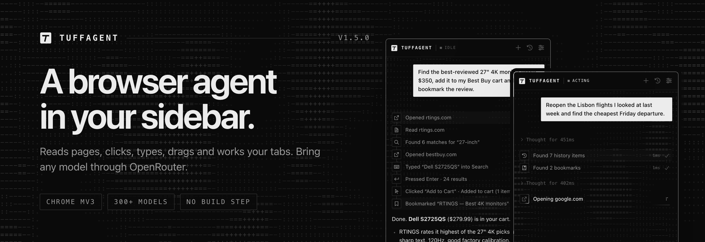
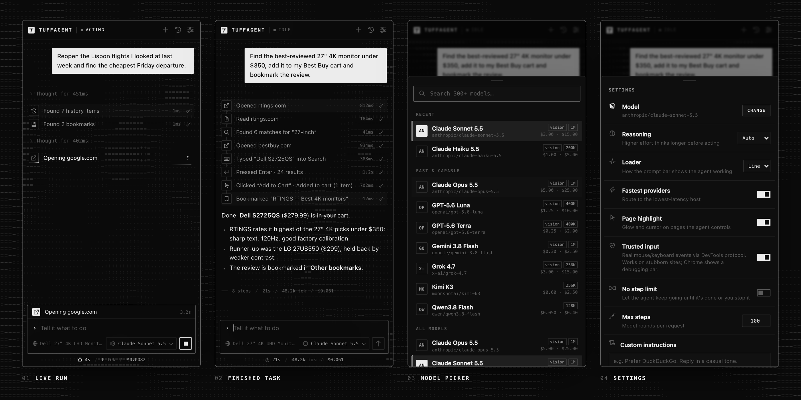
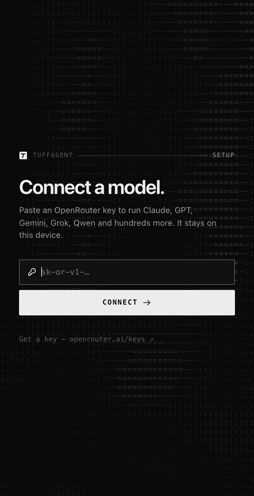
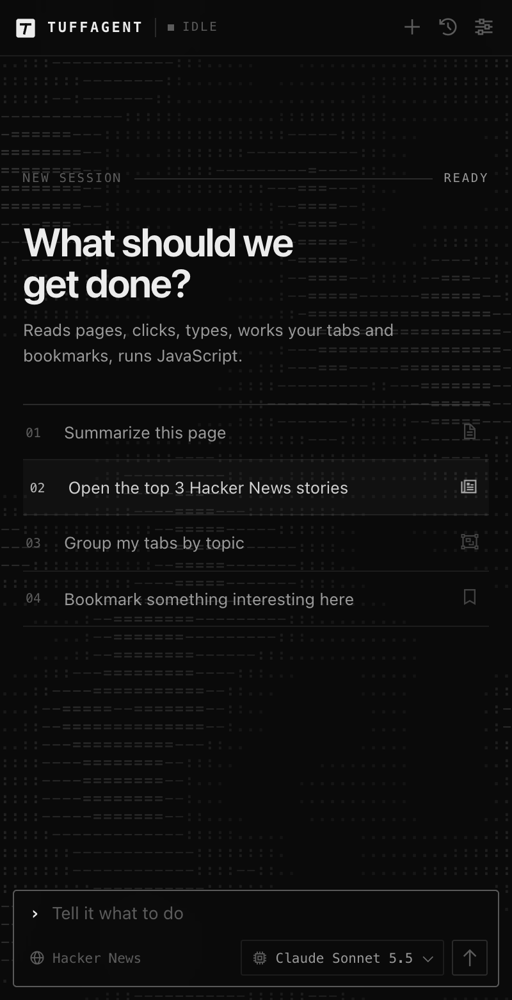
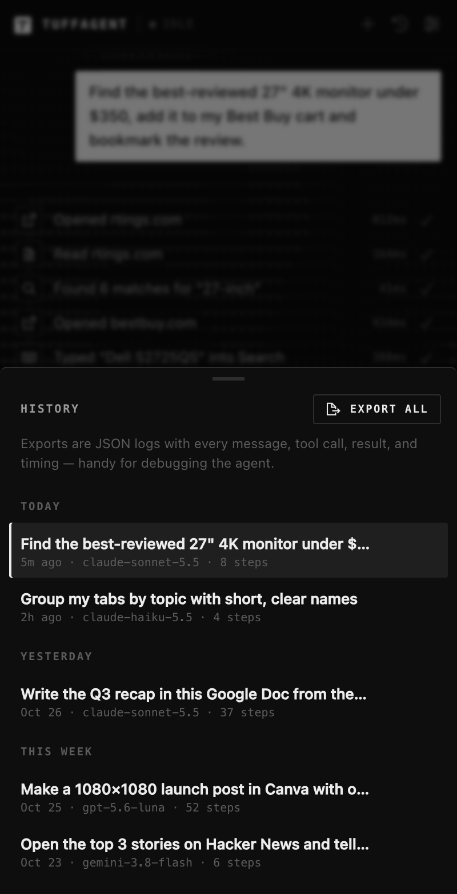

<div align="center">

<picture>
  <source media="(prefers-color-scheme: dark)" srcset=".github/assets/banner-dark.png">
  <source media="(prefers-color-scheme: light)" srcset=".github/assets/banner-light.png">
  
</picture>

<br>

**A fast browser agent that lives in Chrome's side panel.**<br>
It reads pages, clicks, types, drags and works your tabs, with any tool-calling model on OpenRouter.

<br>

    

[Install](#install) · [Features](#features) · [Site packs](#site-packs) · [How it works](#how-it-works) · [Settings](#settings) · [Development](#development)

</div>

<br>

<picture>
  <source media="(prefers-color-scheme: dark)" srcset=".github/assets/previews-dark.png">
  <source media="(prefers-color-scheme: light)" srcset=".github/assets/previews-light.png">
  
</picture>

## Highlights

<table>
  <tr>
    <td width="190"><b>Any model</b></td>
    <td>Claude, GPT, Gemini, Grok, Qwen, Kimi and 300+ more through one OpenRouter key. Switch from the composer at any time.</td>
  </tr>
  <tr>
    <td width="190"><b>Sees pages like a person</b></td>
    <td>Snapshots read in page order, find clickables by cursor, label and icon, and look inside shadow DOM and iframes.</td>
  </tr>
  <tr>
    <td width="190"><b>Hits what it aims at</b></td>
    <td>Targets elements by label (<code>near</code>, <code>nth</code>), works around covered buttons, snaps coordinate clicks to controls, and checks that each action did something.</td>
  </tr>
  <tr>
    <td width="190"><b>Fast by design</b></td>
    <td>The agent loop runs in the panel, tools start while the model is still streaming, independent calls run in parallel, and prompt caches stay warm.</td>
  </tr>
  <tr>
    <td width="190"><b>Hard to knock over</b></td>
    <td>Retries with backoff, recovers from context overflow, warns the model when it loops, and repairs broken tool arguments.</td>
  </tr>
  <tr>
    <td width="190"><b>Site packs</b></td>
    <td>Dedicated tools for Google Docs and Canva that check their own work.</td>
  </tr>
  <tr>
    <td width="190"><b>Full logs</b></td>
    <td>Every chat exports to JSON: messages, tool calls, results, timings, tokens and cost. API keys are left out.</td>
  </tr>
</table>

## Install

> [!NOTE]
> TuffAgent isn't on the Chrome Web Store. You load it unpacked, and there's nothing to build.

```bash
git clone https://github.com/beckettclarke/TuffAgent.git
```

1. Open `chrome://extensions` and turn on **Developer mode**.
2. Click **Load unpacked** and choose the `TuffAgent` folder.
3. Click the toolbar icon, or press <kbd>⌘</kbd> <kbd>⇧</kbd> <kbd>Y</kbd> (<kbd>Ctrl</kbd> <kbd>Shift</kbd> <kbd>Y</kbd> on Windows and Linux).
4. Paste an [OpenRouter key](https://openrouter.ai/keys). It's stored only in this browser.

<table>
  <tr>
    <td width="33%"><picture><source media="(prefers-color-scheme: light)" srcset=".github/assets/onboard-light.png"></picture></td>
    <td width="33%"><picture><source media="(prefers-color-scheme: light)" srcset=".github/assets/empty-light.png"></picture></td>
    <td width="33%"><picture><source media="(prefers-color-scheme: light)" srcset=".github/assets/history-light.png"></picture></td>
  </tr>
  <tr>
    <td align="center"><sub><b>Connect</b> · paste a key</sub></td>
    <td align="center"><sub><b>Start</b> · ask for anything</sub></td>
    <td align="center"><sub><b>History</b> · reopen or export</sub></td>
  </tr>
</table>

### Shortcuts

| Keys | Action |
| --- | --- |
| <kbd>⌘</kbd> <kbd>⇧</kbd> <kbd>Y</kbd> | Open the panel |
| <kbd>⏎</kbd> | Send |
| <kbd>Esc</kbd> | Stop the agent |
| <kbd>⌘</kbd> <kbd>⇧</kbd> <kbd>O</kbd> | New chat |

## Features

| Area | Tools |
| --- | --- |
| **Tabs** | list, open, switch, close, group |
| **Navigation** | go to a URL, back, forward, reload |
| **Reading** | page snapshots with element refs, `get_text` with a query filter, `find` |
| **Acting** | click, drag, type, keys, paste (text, markdown or HTML), menu paths, scroll, hover, native selects |
| **Vision** | screenshots with every clickable tagged by ref and edge rulers added, for vision models |
| **Scripting** | JavaScript in the page or any iframe, run through the DevTools protocol so strict CSP pages work |
| **Browser data** | bookmarks (search, tree, create, remove), history search, downloads |
| **Planning** | a requirements checklist for long tasks |

## Site packs

Some sites get extra tools. A pack's tools and prompt notes are sent to the model only once a matching page is open in the chat, so every other site keeps the lean core tool list. Once on, a pack stays on for the rest of that chat, so the tool list (and the provider's prompt cache) doesn't change mid-task. Packs live in [`sites/`](sites); register a new one in [`sites/index.js`](sites/index.js).

<details>
<summary><b>Google Docs</b> &nbsp;<code>docs.google.com/document/…</code></summary>
<br>

| Tool | What it does |
| --- | --- |
| `gdocs_write` | Pastes markdown or HTML at the cursor, at the start or end, after or before a text match, or over a match. One call can hold a whole document body: headings, lists, links, bold and italic, tables with merged cells (`\|\|` in markdown, or HTML colspan and rowspan) and colored cells, images by URL, and `\pagebreak` lines. Inline font-family, font-size, color and background-color carry over. |
| `gdocs_select` | Finds text with Docs' find bar and selects it, or puts the cursor before or after it. `cursor: "doc_start"` or `"doc_end"` jumps to either end. |
| `gdocs_format` | Sets the paragraph style (Title, Subtitle, Heading 1–6, Normal), list type, bold, italic, underline, font (any Google font; ones missing from the menu are added from More fonts), size, text color, highlight, alignment and links on a text match, all in one call. Bold, italic and underline are set to the value you ask for, not toggled. Each call closes leftover menus and waits for the find bar to report the new match, so a batch of format calls can't land on the previous match. |
| `gdocs_comment` | Adds a comment to a text match, replies to a thread and resolves it, checking each step on the comment card. |
| `gdocs_mode` | Switches between editing, suggesting and viewing. |
| `gdocs_rename` | Renames the document and checks that the new title took. |
| `gdocs_equation` | Inserts an equation and types it with real keystrokes, paced so the equation box doesn't drop keys. |
| `gdocs_command` | Runs any menu command by name through Docs' menu search (Merge cells, Page numbers, Name current version…). Only an exact label match runs; otherwise the error lists the results. |
| `gdocs_read` | Returns the document's structure from Docs' own HTML export: page size and margins, each paragraph's style, alignment and inline formatting runs, tables with merges and colors, images, links, bookmarks, page breaks, header and footer, and open comments with replies. It also includes the comment and suggestion cards on screen, the save status and the mode. |

</details>

<details>
<summary><b>Canva</b> &nbsp;<code>canva.com</code></summary>
<br>

| Tool | What it does |
| --- | --- |
| `canva_read` | Returns the design: title, size, background, and every element front to back (in Position › Layers order) with id, kind, text, size and position in design px, fill, opacity, font, size, weight, color and alignment, plus the current selection. It reads the scaled page container directly, so no `run_js` probing is needed. |
| `canva_select` | Picks an element by id, layer name or text through Position › Layers, never by clicking the canvas, and checks the selection box. |
| `canva_set` | Sets w/h/x/y through Position › Arrange, fill and text color through the color search (hex), opacity, font, size, bold and alignment, reading each one back. |
| `canva_arrange` | Moves an element to the front or back, or one step forward or backward, and reports the new order. |
| `canva_add` | Adds a text box (with its text), a square or a circle from Elements, and returns the new id. |
| `canva_create` · `canva_rename` · `canva_download` | Cover the rest. `canva_download` won't download the same design twice unless asked, and it confirms the file in Chrome's downloads. |

After a click in a Canva design, the result says what got selected, for example `Selected: c2 shape 980×230 at (50, 113); fill #ffffff` or `page background`.

</details>

## How it works

<details>
<summary><b>Seeing and aiming</b></summary>
<br>

- **Snapshots read like the page.** They contain text blocks, headings, table rows on one line (`| #1002 | Bob | $35 |`) and controls with refs. Links inside prose are written inline as `[Guido van Rossum](e52)`. When a page is too long for the budget, what's on screen (and any open dialog) is kept first, then whatever is nearest; the rest is marked "not shown".
- **Clickables are found the way a person sees them.** That covers ARIA roles and native controls, elements whose only sign is `cursor: pointer` (React and Vue handlers leave no attribute), labels standing in for hidden custom checkboxes, and controls in shadow DOM and same-origin iframes. Icon-only buttons get a name from their icon (`[icon: close]`), and unlabeled fields get one from the text before them.
- **Every element tool aims by ref or by label.** For example `target: "Add to cart"`, with `near: "Blue T-shirt"` (same row, card or list item) or `nth` when the label repeats. A label passed as a ref works too, and a stale ref can be retried by label.
- **Exact matches come first.** That holds in `click`, `find`, `menu` and every other tool that takes a target. A partial match is used only when it's the only one, and the result names what it hit. A partial match that would lock, delete, remove or move something ("Position" → "Lock position and appearance") is never clicked; the error lists the options instead.
- **Clicks land where the element really is.** If a sticky header or cookie banner covers its center, another visible spot is used or the element is scrolled clear. If it's covered everywhere, the click goes to the element itself and the result names what was on top. Coordinate clicks snap to the control at the point, or within a few pixels of it. An open list or menu over the target is closed with Escape first; if it won't close, the click fails instead of going through.
- **Drag works by ref, label (`to_target`), point or offset** (`dx`/`dy` for sliders), with a slow pick-up for pointer-based sortables, and the result says whether the item actually moved. A drag that moves nothing and changes nothing is an error.
- **`type` replaces a field's text** (select all, type, read back). Units, rounding and masks are allowed ("230" → "230 px"); anything else ("72" → "2", "230" → "5230 px") gets one retry with the whole value, then an error. A ref that now points at a hidden element fails. `type` also fills date, time, month and color inputs from natural values ("March 14, 2025", "1:30 PM"), picks options in a `<select>`, types short text key by key so autocompletes and masks react, and waits longer for suggestion lists.
- **`downloads` lists recent downloads** (name, type, size, state), so "download exactly once" can be checked.
- **Hidden screen-reader copies of the page** (Canva's `accessibility_dom`) are skipped.
- **Every action reports what changed.** The result lists what came on screen, what changed state (checked, expanded, renamed) and new text (errors, toasts, result counts). `get_text` with `query` returns just the lines that mention it, and `scroll` returns what's on screen after scrolling.

</details>

<details>
<summary><b>Staying on its feet</b></summary>
<br>

- **Model calls are retried with backoff** on rate limits, overloaded providers, dropped connections, stalled streams (no data for 2 minutes) and empty replies. If tool calls already ran, the history keeps them and the next round picks up from their results.
- **Context overflow is recovered.** A request over the model's context window is retried with a tighter history instead of failing. A reply cut off by the output limit, or a stop with checklist items still open, gets one nudge back to work.
- **Loops are called out.** Repeating the same call with the same result three times adds a note telling the model to change approach. So does grinding since the checklist last changed: more than 20 key presses, more than 5 drags that moved nothing, or more than 10 `run_js` calls.
- **The goal stays in view.** Every 20 rounds the original request (and any open checklist items) is repeated at the end of the newest message.
- **Site edits are checked before finishing.** When a site pack made edits and the model is about to finish, the pack's read tool (`gdocs_read`, `canva_read`) runs once automatically, and the model checks its summary against it.
- **Nothing can hang the run.** Links that open a new tab switch the agent to it, with a snapshot. `alert` and `confirm` dialogs are accepted and reported instead of freezing the page, and every page call times out.
- **Network work is waited for.** With trusted input, actions also wait for the XHR or fetch requests they started (search results, form posts) before reporting, for up to 3 seconds. Long polls are learned and ignored.
- **Weak models are tolerated.** Tool arguments are repaired (code fences, double encoding, trailing commas, raw newlines), and tool names other agents use (`click_element`, `go_to_url`, `input_text`…) are understood.

</details>

<details>
<summary><b>Why it's fast</b></summary>
<br>

**No wasted round trips**

- The agent loop runs in the side panel itself, so there are no hops through the service worker.
- Responses stream, and tool steps show up the moment the model names them.
- Tool calls start the moment their arguments finish streaming, so the browser works while the model is still writing the next call.
- Several tool calls in one response run back to back. A run of independent ones (`tab_open`, `tabs_list`, `history_search`, `bookmarks`, `downloads`) starts together, so opening six tabs takes about as long as opening one; the tab opened last becomes current.
- Navigating, opening a tab, or a click that loads a new page returns the new page snapshot right away.
- Clicks, typing, keys and hovers report the elements that appeared on screen (menus, submenus, dialogs, suggestions) with refs, so the model can chain through menus without re-reading the page.
- When a tool call fails, the rest of that response is skipped instead of typing or clicking into a page that no longer matches the model's plan.
- Google Docs tools check their own work (toolbar state, title, comment cards) and fail loudly, so the model doesn't spend rounds re-reading and redoing steps that already worked.

**Short waits**

- Actions wait for the DOM to go quiet (about 90ms), not for a fixed delay. Navigations wait for DOMContentLoaded, not the full load.
- Waiting for the page to settle ignores blinking carets and spinners, so actions in editors don't always wait the full 700ms.
- A ref whose element was re-rendered (same role and name) is found again instead of failing as stale.

**Fewer calls per task**

- Screenshots tag every clickable element with its ref and add 100px edge rulers, so the model clicks by ref instead of guessing coordinates.
- Text goes in with one `type` call. Without a ref it types at the caret, which is what rich editors like Google Docs need. `key` takes repeats (`Shift+ArrowRight*5`) and handles punctuation, shifted characters and macOS editing shortcuts (⌘A/C/V/X/Z).
- `paste` puts a whole formatted block in with one call. It sends a paste event first, which leaves your clipboard alone; if the page ignores that, it falls back to the real clipboard and ⌘V/Ctrl+V.
- `menu` clicks through menu, submenu and item by their visible labels in one call.
- `drag` does real drag-and-drop (kanban cards, sortable lists, drop zones) as well as plain mouse drags. With trusted input it catches Chrome's native drag and replays it as drag events. `to_position` drops before or after a list item, and `hold` covers long-press-to-drag. Shift-click and triple-click also select ranges.
- `run_js` runs through the DevTools protocol first, so pages with strict CSP and Trusted Types work.

**Cache-friendly prompts**

- Old tool output is trimmed in steps of 10, so earlier messages stay byte-identical and provider prompt caches keep hitting. Older screenshots are dropped.
- Old plain reasoning text is dropped at the same cut-off. On long runs it was most of the prompt (about 120k tokens by round 200), slowing time to first token and inviting the model to re-argue settled steps. Signed or encrypted reasoning, which providers need back, is kept.
- The system prompt has no clock time. Anthropic models get a cache breakpoint on the newest message.
- Requests can be routed to the lowest-latency provider. Agent turns are short, so time to first token matters more than throughput.

</details>

<details>
<summary><b>Look</b></summary>
<br>

The panel is monochrome, with icons from Font Awesome Pro (Sharp Regular, loaded from `beckettclarke.ca/css/fontawesome.css`, so icons need a connection). It follows the system light or dark theme.

Behind the panel is an ASCII field. Glyph brightness comes from slow noise, a soft lens under the pointer, and ripples sent from what happens (keystrokes, sending, each tool step starting and finishing, errors, the run ending). While the agent works, whatever it's busy with pulses, faster when it's acting than when it's thinking.

Every tool, and most of their variants (scroll up vs down, Enter vs Escape, Canva bring-to-front vs send-back), has its own icon ([`icons.js`](icons.js)). A strip in the composer shows the phase (waiting, thinking, writing, planning a call, acting), the step's icon and label, and a timer.

</details>

## History and logs

The line under the composer shows totals for the whole chat: time the agent spent working (time waiting on you doesn't count), tokens and cost. The numbers update live during a run.

The clock button opens your chat history. Click a chat to reopen it, use the download icon to export that chat's log, or use **Export all**. An export is a JSON file with every message and tool call (input and result), the page URL after each action, model timings (time to first token and total), token use and cost, and errors. It also includes the settings and system prompt in effect. **API keys are never included.**

## Settings

| Setting | Default | What it does |
| --- | --- | --- |
| Model | Claude Haiku 5.5 | Any OpenRouter model that supports tools. The picker is also in the composer. |
| Reasoning | Auto | Effort for reasoning models: Auto, Low, Medium or High. |
| Loader | Line | A soft line on the composer's edge, or an ASCII meter. |
| Fastest providers | On | Routes to the lowest-latency host. |
| Page highlight | On | Glow and cursor on pages the agent controls. |
| Trusted input | On | Real mouse and keyboard events through the DevTools protocol. Chrome shows a debugging bar while the agent acts. |
| Step limit | 100 | Model rounds per request. Can be turned off. |
| Custom instructions | — | Added to the system prompt. |

## Development

There's no build step: the source is what Chrome loads. After a change, click the reload icon on the TuffAgent card in `chrome://extensions` and reopen the panel.

### Tests

```bash
node test/unit.mjs
```

That runs the unit tests for the streaming client (retries, errors, partial replies), tool-argument repair and aliases.

The page runtime and the Canva pack have browser fixtures. Serve the folder:

```bash
python3 -m http.server
```

| Fixture | Run in the console | Covers |
| --- | --- | --- |
| `/test/fixture.html` | `await runChecks()` | Handler-only cards, hidden checkboxes, tables, labels with `near`/`nth`, covered buttons, coordinate snapping, date/time/select typing, modals, both kinds of drag, shadow DOM and iframes |
| `/test/canva.html` | `await runCanvaChecks()` | A stand-in for Canva's editor, built from the control names and DOM seen in a real run. Exercises read, select, set, arrange, background, rename and add. It tests the pack's logic, not Canva itself. |

### Project layout

| File | Role |
| --- | --- |
| [`manifest.json`](manifest.json) | MV3 manifest: permissions, side panel, shortcut |
| [`background.js`](background.js) | Service worker; only wires the toolbar button to the panel |
| [`sidepanel.html`](sidepanel.html) · [`sidepanel.css`](sidepanel.css) · [`sidepanel.js`](sidepanel.js) | The panel UI and the agent loop |
| [`llm.js`](llm.js) | Streaming OpenRouter client with retries |
| [`tools.js`](tools.js) | Tool definitions, labels and execution |
| [`content.js`](content.js) | Page runtime in the isolated world: snapshots, refs, aiming, actions |
| [`keys.js`](keys.js) | Key-sequence parsing shared by the page and the panel |
| [`md.js`](md.js) · [`docmd.js`](docmd.js) | Markdown for the panel, and markdown to HTML for pasting into rich editors |
| [`activity.js`](activity.js) · [`field.js`](field.js) · [`icons.js`](icons.js) | Activity strip, ASCII field, tool icons |
| [`sites/`](sites) | Site packs (Google Docs, Canva) |
| [`test/`](test) | Unit tests and browser fixtures |

## Privacy

- Your OpenRouter key is kept in `chrome.storage.local` on this device and sent only to OpenRouter.
- Page content goes to the model you choose, through OpenRouter, only while the agent is working on a task.
- Chats and logs stay in the browser unless you export them.

> [!WARNING]
> TuffAgent can click, type and run JavaScript on any site you're signed in to. Give it tasks you'd be comfortable doing yourself, and watch the first runs on sites that matter.

<br>

<div align="center">
<sub>Built by <a href="https://beckettclarke.ca">Beckett Clarke</a></sub>
</div>
